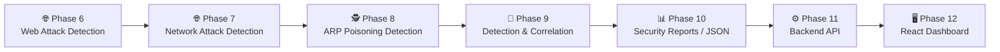

# 🛡️ Security Log Analyzer


A modular **TypeScript cybersecurity log analyzer** designed to parse system logs, validate events, detect suspicious authentication activity, generate structured security alerts, and send intelligent email notifications.

The long-term goal of the project is to evolve into a lightweight **SIEM-style security monitoring platform** with web attack detection, network analysis, correlation, reporting, an API, and a React dashboard.

---

# 📌 Project Status

## ✅ Completed

| Phase | Status |
|---|---|
| Phase 1 — Basic TypeScript Log Parser | ✅ Completed |
| Phase 2 — Log Validation | ✅ Completed |
| Phase 3 — Authentication Attack Detection | ✅ Completed |
| Phase 4 — TypeScript Architecture & Refactoring | ✅ Completed |
| Phase 5 — Structured Alerts & Email Notifications | ✅ Completed |

---

# 🚀 What's Coming Next?



### Future Enhancement

📱 **Telegram Security Notifications**

Telegram integration is planned after the core Log Analyzer is complete and will provide mobile HIGH/CRITICAL security notifications using the existing alert system.

---

# 🎯 Project Purpose

Security logs can contain thousands of events, making manual analysis difficult.

This project converts raw log entries into structured data and automatically looks for patterns associated with suspicious activity.

The analyzer currently focuses on authentication security events and can detect patterns such as:

- Brute-force login attempts
- Time-based brute-force attacks
- Password-spraying attacks
- Distributed attacks against accounts
- Successful logins after repeated failures

The architecture is designed so additional detection engines can be added as the project grows.

---

# 🧠 How It Works

```text
             Raw Log File
                  │
                  ▼
             ┌─────────┐
             │ Parser  │
             └────┬────┘
                  │
                  ▼
           ┌─────────────┐
           │  Validator  │
           └──────┬──────┘
                  │
                  ▼
           ┌─────────────┐
           │  Analyzer   │
           └──────┬──────┘
                  │
                  ▼
      ┌─────────────────────────┐
      │ Security Detection      │
      │ Engines                 │
      └────────────┬────────────┘
                   │
                   ▼
          ┌─────────────────┐
          │ Structured      │
          │ Security Alerts │
          └────────┬────────┘
                   │
                   ▼
          ┌─────────────────┐
          │ Notification    │
          │ Manager         │
          └────────┬────────┘
                   │
          HIGH / CRITICAL
                   │
                   ▼
          ┌─────────────────┐
          │ Combined Email  │
          │ Security Report │
          └─────────────────┘
```

---

# 🔍 Current Detection Capabilities

## Brute-Force Detection

Detects multiple failed login attempts from the same IP address within a configurable period.

## Password Spraying

Detects one IP address attempting to authenticate against multiple different usernames.

## Distributed Account Attack

Detects several different IP addresses attempting to authenticate against the same account.

## Success After Repeated Failures

Detects situations where several failed authentication attempts are followed by a successful login.

This can indicate that an attacker eventually obtained valid credentials.

---

# 🚨 Structured Security Alerts

Detectors generate structured alert objects instead of simple strings.

An alert can contain:

```typescript
{
  type: "SUCCESS_AFTER_FAILURES",
  severity: "HIGH",
  sourceIp: "90.20.30.40",
  username: "finance",
  detectedAt: "...",
  eventTimestamp: "...",
  message: "...",
  evidence: {
    failedAttempts: 3,
    windowMinutes: 5
  }
}
```

This makes alerts reusable across:

- Console output
- Email notifications
- JSON reports
- Future APIs
- Future dashboards
- Future Telegram notifications

---

# 📧 Intelligent Email Notifications

The analyzer includes an email notification system using **Nodemailer**.

Only:

```text
HIGH
CRITICAL
```

alerts generate email notifications.

Multiple alerts detected during the same analysis are combined into **one security summary email** instead of sending a separate email for every event.

Example:

```text
[HIGH] Security Alert Summary - 2 alert(s) detected

ALERT 1
DISTRIBUTED_ACCOUNT_ATTACK

ALERT 2
SUCCESS_AFTER_FAILURES
```

---

# ♻️ Duplicate Protection

The analyzer stores notification history locally using:

```text
.notification-state.json
```

Previously sent alerts receive a unique SHA-256 fingerprint.

If the exact same event is detected again:

```text
Alert Detected
      │
      ▼
Fingerprint Generated
      │
      ▼
Already Sent?
   │       │
  YES      NO
   │       │
 Skip     Continue
```

This prevents repeated execution of the analyzer from flooding the inbox with duplicate emails.

---

# ⏳ Notification Cooldown

The notification manager also includes a configurable cooldown.

A similar but newly generated alert occurring shortly after an existing notification can be temporarily suppressed.

The default cooldown is:

```text
10 minutes
```

It can be changed through the environment configuration.

---

# 🗂️ Project Structure

```text
security-log-analyzer/
│
├── logs/
│   └── sample.log
│
├── src/
│   │
│   ├── detectors/
│   │   ├── bruteForce.ts
│   │   ├── distributedAttack.ts
│   │   ├── passwordSpray.ts
│   │   └── successAfterFailures.ts
│   │
│   ├── notification/
│   │   ├── emailnotifier.ts
│   │   ├── notificationManager.ts
│   │   └── notificationStore.ts
│   │
│   ├── analyzer.ts
│   ├── index.ts
│   ├── parser.ts
│   ├── severity.ts
│   ├── types.ts
│   └── validator.ts
│
├── .gitignore
├── package.json
├── package-lock.json
├── tsconfig.json
├── LICENSE
└── README.md
```

---

# 🧪 Example Log Format

```text
2026-08-07 09:02:14 LOGIN_FAILED user=admin ip=45.22.18.91
2026-08-07 09:02:20 LOGIN_FAILED user=admin ip=45.22.18.91
2026-08-07 09:02:27 LOGIN_FAILED user=admin ip=45.22.18.91
2026-08-07 09:05:10 LOGIN_SUCCESS user=ahmed ip=192.168.1.22
```

The parser converts these entries into structured TypeScript objects before analysis.

---

# ✅ Log Validation

Malformed log entries are rejected without stopping the analyzer.

Validation currently checks:

- Required fields
- Username presence
- IP address presence
- IPv4 validity
- Date validity
- Time validity
- Supported event types
- Unexpected fields
- Duplicate fields

Invalid logs are reported while valid events continue through the security analysis pipeline.

---

# ⚠️ Severity Levels

Security events are classified using four severity levels:

```text
LOW
MEDIUM
HIGH
CRITICAL
```

Severity determines how suspicious activity is handled and whether an email notification should be generated.

---

# 🛠️ Technologies

| Technology | Purpose |
|---|---|
| TypeScript | Main programming language |
| Node.js | Application runtime |
| Nodemailer | Email notification delivery |
| Git | Version control |
| GitHub | Source code hosting |

---

# ⚙️ Installation

Clone the repository:

```bash
git clone https://github.com/mczdj/security-log-analyzer.git
```

Enter the project directory:

```bash
cd security-log-analyzer
```

Install dependencies:

```bash
npm install
```

Compile TypeScript:

```bash
npx tsc
```

---

# 🔐 Environment Configuration

Create a `.env` file in the project root.

```env
GMAIL_USER=your-email@gmail.com
GMAIL_APP_PASSWORD=your-app-password
ALERT_EMAIL=security-alert-recipient@example.com

NOTIFICATION_COOLDOWN_MINUTES=10
```

> [!IMPORTANT]
> Never commit `.env` to GitHub.
>
> Gmail App Passwords and other credentials must remain private.

The repository's `.gitignore` prevents `.env` from being tracked.

---

# ▶️ Running the Analyzer

Compile:

```bash
npx tsc
```

Run the application while loading environment variables:

```bash
node --env-file=.env dist/index.js
```

---

# 🖥️ Example Console Output

```text
===== AUTHENTICATION SUMMARY =====

Total valid events: 22
Successful logins: 5
Failed logins: 17

===== SECURITY ALERTS =====

⚠ [MEDIUM] Possible brute-force attack
⚠ [MEDIUM] Possible password-spraying attack

🚨 [HIGH] Possible distributed account attack
🚨 [HIGH] Successful login after repeated failures

===== NOTIFICATIONS =====

📧 Security summary email sent with 2 alert(s)

===== NOTIFICATION SUMMARY =====

Emails sent: 1
Alerts included in emails: 2
Duplicates skipped: 0
Cooldown skips: 0
Failed notifications: 0
```

---

# 🔒 Security Considerations

This project is intended for:

- Cybersecurity learning
- Defensive security experimentation
- Log-analysis development
- Authorized security environments

Do not commit credentials, API keys, passwords, private production logs, or other sensitive information to the repository.

Real organizational logs should be sanitized before being used for testing or demonstrations.

---

# 🧩 Development Philosophy

The project is being built incrementally.

Each phase introduces new cybersecurity concepts while keeping the code modular enough for future detectors and data sources to integrate into the same alert pipeline.

The eventual architecture is intended to resemble a lightweight SIEM:

```text
Multiple Log Sources
        │
        ▼
Parsing & Validation
        │
        ▼
Detection Engines
        │
        ▼
Correlation
        │
        ▼
Risk Scoring
        │
        ▼
Security API
        │
        ▼
React Dashboard
```

---

# 🤝 Contributions

Suggestions, improvements, bug reports, and educational contributions are welcome.

If contributing code:

1. Fork the repository.
2. Create a feature branch.
3. Make your changes.
4. Test the analyzer.
5. Submit a pull request.

---

# 📜 License

This project is licensed under the **MIT License**.

See the `LICENSE` file for details.

---

# ⚡ Current Milestone

```text
████████████████████░░░░░░░░░░░░░░░░░░░░

Phases Completed: 5 / 12

Current Progress
━━━━━━━━━━━━━━━━━━━━━━━━━━━━━━━━━━━━━━━━━━
✅ Parser
✅ Validation
✅ Authentication Detection
✅ Architecture
✅ Alert & Email System
━━━━━━━━━━━━━━━━━━━━━━━━━━━━━━━━━━━━━━━━━━
🚀 Next: Web Attack Detection
```

---

<p align="center">
  <strong>🛡️ Security Log Analyzer</strong>
  <br>
  Built as a hands-on cybersecurity and TypeScript learning project.
</p>